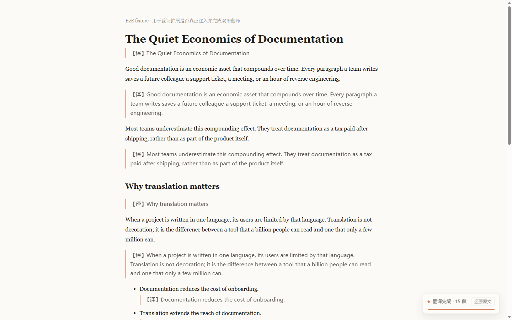
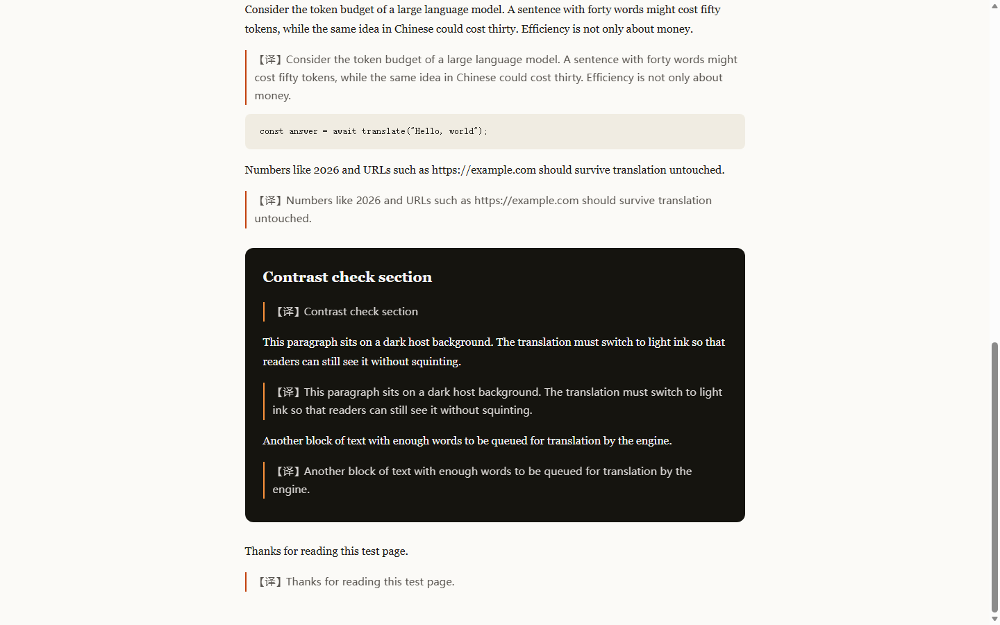
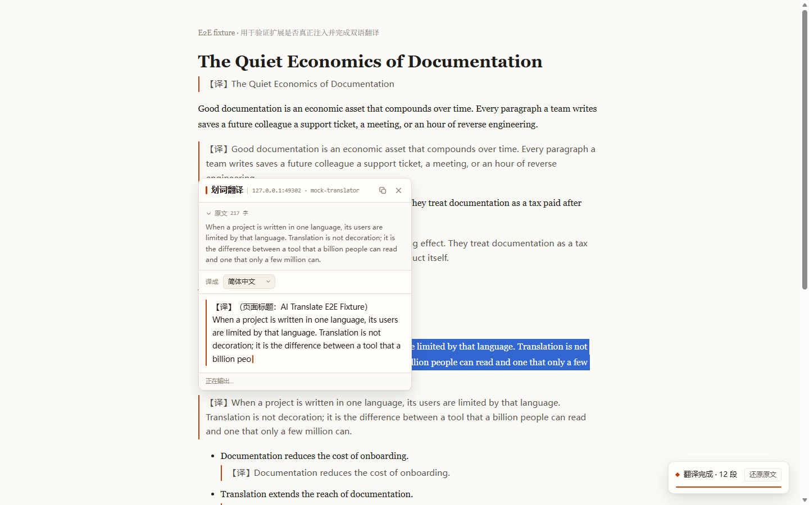

# AI 双语翻译（Edge 扩展）

用大模型翻译网页的 Microsoft Edge 扩展：**全页双语对照、划词流式翻译、术语表与本地缓存**，支持 DeepSeek / OpenAI / Ollama 等任意 OpenAI 兼容接口。

零构建、零依赖：下载后直接在 Edge 里「加载解压缩的扩展」即可使用，源码可读可改。

## 为什么再做一个翻译扩展

动手前调研了 GitHub 上 6 个同类项目（见 [docs/RESEARCH.md](docs/RESEARCH.md)），发现两个普遍问题：

1. 几乎全部需要 npm install + 构建，想改一行代码要先装一套前端工具链；
2. 配置项多，但缺少「测试连接」和错误解释，大量 issue 都是 Base URL 填错。

这个项目反过来做：**下载即用、配置即验、AI 原生**。

| | 本项目 | 沉浸式翻译 | KISS Translator | FluentRead | Dual Read |
| --- | :-: | :-: | :-: | :-: | :-: |
| 开源可读 | 有 | 部分 | 有 | 有 | 有 |
| 免构建直接加载 | 有 | 无 | 无 | 无 | 无 |
| 全页双语 | 有 | 有 | 有 | 有 | 有 |
| 划词流式翻译 | 有 | 有 | 有 | 有 | 有 |
| 本地缓存 | 有 | 云端 | 本地 | 本地 | 有 |
| 术语表 | 有 | 有 | 有 | 有 | 无 |
| 站点自动翻译规则 | 精简 | 有 | 极强 | 有 | 有 |

## 功能

- **全页双语翻译**：段落级对照，译文插在原文下方；可切换「仅译文」；随时一键还原。
- **划词翻译**：选中文字出现「译」按钮，点击弹出卡片，流式打字机输出；支持复制、原文折叠、Esc 关闭。
- **大模型接入**：任何 OpenAI 兼容的 Chat Completions 服务；内置 DeepSeek / OpenAI / Ollama / SiliconFlow 预设。
- **省钱的三层优化**：本地 LRU 缓存、批量聚合请求、视口优先懒加载。
- **质量可控**：术语表、自定义系统提示词、温度与超时。
- **站点规则**：按域名自动翻译或永不翻译。
- **用量透明**：请求数、段落数、缓存命中、token 估算，全部本地。
- **动态注入**：扩展安装/重载前已打开的标签页，点图标或按快捷键时自动注入，无需手动刷新。
- **宿主背景自适应**：系统主题与网页主题不一致时，译文自动切换配色（深色底对比度 12.38:1）。
- **暗色模式**：跟随系统，译文样式克制，不抢原文注意力。

## 效果

深色宿主页面自动适配（不会出现深灰字写在深色底上）：

划词翻译（真实扩展 + 流式输出，卡片与页面样式完全隔离）：

## 安装（Edge）

1. 下载本仓库（或 [release](release/) 里的 zip 解压）。
2. 打开 Edge，地址栏输入：edge://extensions/
3. 打开左侧「开发人员模式」。
4. 点击「加载解压缩的扩展」，选择仓库里的 **extension** 目录（不是仓库根目录）。
5. 把扩展图标固定到工具栏，点击图标 → 设置。

> 安装或重新加载扩展后，已经打开的标签页不需要手动刷新：点图标或按快捷键时扩展会自动注入页面脚本。

## 配置

首次安装会自动打开设置页。最少只需要填两项：

    服务地址（Base URL）   https://api.deepseek.com/v1
    API Key                sk-...
    模型                   deepseek-chat

点「测试连接」应返回成功与延迟毫秒数；点「拉取模型」可以列出该接口支持的模型。

| 服务 | Base URL | 模型示例 |
| --- | --- | --- |
| DeepSeek | https://api.deepseek.com/v1 | deepseek-chat |
| OpenAI | https://api.openai.com/v1 | gpt-4o-mini |
| Ollama（本地） | http://localhost:11434/v1 | qwen2.5:7b |
| SiliconFlow | https://api.siliconflow.cn/v1 | deepseek-ai/DeepSeek-V3 |
| 各类中转站 | 站点文档给出的 /v1 地址 | 按站点说明 |

## 没有 API Key？先看效果

仓库自带本地 mock 服务，不消耗任何额度就能验证整条链路：

    node extension/scripts/mock-server.mjs

然后在扩展设置里填 Base URL = http://127.0.0.1:8787/v1、API Key = mock、模型 = mock-translator，打开任意英文网页按 Alt+T。

## 使用

| 操作 | 方式 |
| --- | --- |
| 翻译 / 还原整页 | 点扩展图标打开控制面板 → 主按钮；或 Alt+T |
| 打开控制面板 | 点一次扩展图标（默认行为，不会被翻译占用） |
| 切换双语 / 仅译文 | Alt+M |
| 翻译选中文字 | 选中后点「译」按钮，或 Alt+S |
| 右键菜单 | 选中文字或页面空白处右键（只保留两个入口） |
| 修改快捷键 | edge://extensions/shortcuts |

## 隐私

- API Key 只保存在本机的 chrome.storage.local，只在 background service worker 中使用，网页上下文拿不到。
- 网页文本只发送到你配置的那个 API 服务，不经过任何第三方中转。
- 无遥测、无账号、无统计上报。缓存与用量统计全部本地可清空。

## 目录结构

    extension/           扩展本体（可直接加载）
      src/shared/        配置、存储、API、提示词、缓存、统计、动态注入
      src/background/    唯一发网络请求的 Service Worker
      src/content/       全页翻译引擎 + 划词浮层
      src/popup/         工具栏弹窗
      src/options/       设置页
      tests/             Node 单元测试、静态检查、UI 复核、页面夹具
      scripts/           图标生成、打包、mock 服务、端到端验证
    docs/
      RESEARCH.md        GitHub 同类项目调研
      ARCHITECTURE.md    接口契约与设计 brief
      TESTING.md         测试与验收记录
      CHANGELOG.md       更新日志
      screenshots/       验收截图

## 开发

不需要安装任何依赖。

    # 单元测试（139 用例）
    node --test "extension/tests/*.test.mjs"

    # 静态检查（manifest 引用、语法、零依赖、编码规范等 57 项）
    node extension/tests/static-check.mjs

    # 端到端：headless Edge 加载真实扩展 + 本地 mock LLM
    node extension/scripts/e2e.mjs

    # 动态注入验收（模拟「安装前已打开的标签页」）
    node extension/scripts/e2e-inject.mjs

    # 重新生成图标（需要 Python + Pillow）
    python extension/scripts/make-icons.py

    # 打包为可分发 zip
    powershell -ExecutionPolicy Bypass -File extension/scripts/pack.ps1

调试：修改代码后在 edge://extensions/ 点击扩展卡片上的「重新加载」；页面需刷新后旧内容脚本才会更新。

## 已知限制

- 只翻译普通 DOM 页面：PDF、图片文字、视频字幕、Shadow DOM 内部文字暂不支持。
- iframe 内的内容不翻译（content_scripts 只在顶层页面注入）。
- 依赖模型本身的质量：小模型可能不遵守编号协议，此时扩展会自动降级为单段重试，速度会变慢。
- 极长页面首次翻译会产生较多 token，建议先在小页面确认模型效果。
- 商店上架需要补充隐私政策页面；当前为「加载解压缩」的自用形态。

## 许可

[MIT](LICENSE)
